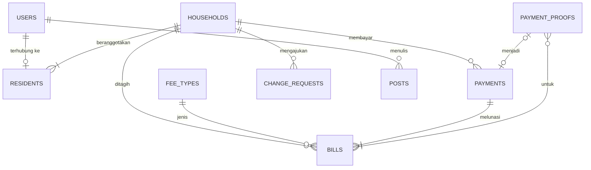
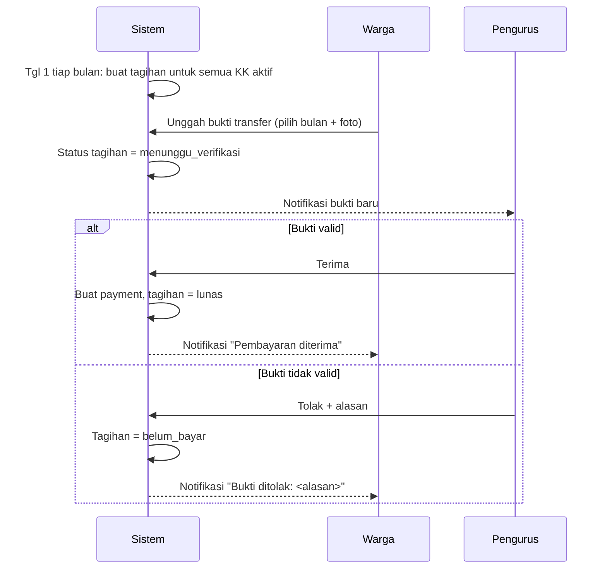

# Desain Aplikasi Administrasi RT

## 1. Ringkasan

Aplikasi ini membantu pengurus RT mengelola **data warga**, **iuran**, dan **berita/kegiatan**.
Aplikasi dipakai dari HP (tampilan seperti aplikasi) dan dari laptop/PC (tampilan web penuh).

Prinsip desain:
- **Satu backend, banyak tampilan.** Aturan bisnis dan hak akses hanya ada di server. Web dan aplikasi HP hanya menampilkan data.
- **Unit iuran adalah keluarga/rumah (KK), bukan per orang.** Satu KK punya beberapa anggota, tetapi tagihannya satu.
- **Privasi warga.** Warga hanya bisa melihat data dirinya dan keluarganya. Rekap iuran keseluruhan yang dilihat warga hanya berisi nama kepala keluarga, nomor rumah, dan status bayar, tanpa NIK, telepon, atau data pribadi lain. Ini sejalan dengan UU No. 27/2022 tentang Pelindungan Data Pribadi.

## 2. Peran dan hak akses

| Fitur | Admin | Pengurus | Warga |
|---|---|---|---|
| Kelola akun pengguna & peran | ✅ | ❌ | ❌ |
| Pengaturan RT (nama RT, jenis & nominal iuran, rekening) | ✅ | ❌ | ❌ |
| Lihat data **semua** warga | ✅ | ✅ | ❌ |
| Tambah / ubah / nonaktifkan data warga | ✅ | ✅ | ❌ |
| Lihat & ubah data **diri sendiri / keluarga sendiri** | ✅ | ✅ | ✅ |
| Setujui perubahan data sensitif dari warga (NIK, No. KK) | ✅ | ✅ | ❌ |
| Buat tagihan iuran bulanan | ✅ | ✅ | ❌ |
| Catat pembayaran (lunas / belum) | ✅ | ✅ | ❌ |
| Verifikasi bukti bayar dari warga | ✅ | ✅ | ❌ |
| Lihat rekap iuran per warga & keseluruhan (lengkap) | ✅ | ✅ | ❌ |
| Lihat rekap iuran **sendiri** | ✅ | ✅ | ✅ |
| Lihat rekap iuran **keseluruhan** (versi ringkas) | ✅ | ✅ | ✅ |
| Unggah bukti pembayaran | ✅ | ✅ | ✅ |
| Buat / ubah / hapus berita & kegiatan | ✅ | ✅ | ❌ |
| Baca berita & kegiatan | ✅ | ✅ | ✅ |
| Lihat laporan Kas RT & unduh laporan kas (Excel/PDF) | ✅ | ✅ | ✅ |
| Catat / ubah / hapus transaksi kas | ✅ | ✅ | ❌ |
| Ekspor data warga & rekap iuran (Excel/PDF) | ✅ | ✅ | ❌ |
| Mendaftar sendiri sebagai warga baru (tanpa login) | — | — | ✅ |
| Aktivasi / tolak pendaftaran warga baru | ✅ | ✅ | ❌ |
| Lihat log aktivitas (audit) | ✅ | ❌ | ❌ |

Catatan:
- Seorang pengurus juga warga. Satu akun bisa punya peran `pengurus` sekaligus terhubung ke data warganya sendiri.
- **Usulan perubahan data warga:** perubahan data kontak (telepon, pekerjaan, foto) langsung tersimpan. Perubahan data identitas (NIK, No. KK, nama, tanggal lahir) masuk antrean **"Menunggu persetujuan"** dan baru berlaku setelah disetujui pengurus. Dengan begitu warga tetap bisa memperbarui datanya, tetapi data resmi RT tetap valid.

## 3. Modul dan fitur

### 3.1 Data Warga
- **Keluarga (KK):** No. KK, alamat/blok/no. rumah, status hunian (pemilik / kontrak / kos), tanggal mulai tinggal.
- **Anggota keluarga:** NIK, nama, jenis kelamin, tempat & tanggal lahir, agama, status perkawinan, hubungan dalam keluarga, pekerjaan, no. HP, status (aktif / pindah / meninggal).
- Pengurus: daftar warga dengan pencarian & filter (blok, status hunian, status aktif), detail keluarga, tambah/ubah, ekspor ke Excel/PDF.
- Warga: halaman "Data Saya" berisi data keluarga sendiri, tombol **Ajukan perubahan**, dan riwayat pengajuan.
- Statistik ringkas: jumlah KK, jumlah jiwa, komposisi usia dan jenis kelamin.

### 3.2 Iuran
- **Jenis iuran** diatur admin, misalnya Kebersihan Rp20.000, Keamanan Rp30.000, Kas Sosial Rp10.000. Bisa bulanan atau sekali bayar (misalnya iuran 17 Agustus).
- **Tagihan** dibuat otomatis tiap awal bulan untuk setiap KK aktif, atau dibuat manual oleh pengurus.
- **Status tagihan:** `belum_bayar` → `menunggu_verifikasi` (warga sudah unggah bukti) → `lunas`. Jika bukti ditolak, status kembali ke `belum_bayar` dengan alasan penolakan.
- **Pengurus mencatat pembayaran:** pilih KK, centang bulan yang dibayar, lalu pilih metode (tunai / transfer / QRIS). Satu pembayaran bisa melunasi beberapa bulan sekaligus.
- **Warga mengunggah bukti:** pilih bulan yang dibayar, unggah foto/screenshot transfer, isi nominal dan tanggal transfer, lalu kirim. Pengurus mendapat notifikasi.
- **Bayar beberapa bulan sekaligus & bayar di muka:** satu bukti transfer (atau satu catatan tunai) boleh mencakup beberapa bulan, termasuk sampai **12 bulan ke depan**. Tagihan bulan mendatang dibuat saat dipilih, dengan tarif yang berlaku saat itu; jika tarif naik kemudian, bulan yang sudah dibayar tetap lunas. Pembuatan tagihan bulanan otomatis tidak menggandakannya.
- **Lebih/kurang bayar dan saldo titipan:**
  - Kas mencatat **uang yang benar-benar diterima**, bukan total tagihan. Saat verifikasi, pengurus bisa mengoreksi nominal sesuai mutasi rekening.
  - Uang + saldo titipan KK dialokasikan **per bulan utuh, mulai dari bulan tertua**. Satu bulan baru lunas jika semua jenis iurannya tertutup.
  - **Lebih bayar:** sisanya menjadi **saldo titipan** KK dan otomatis melunasi tagihan berikutnya (termasuk saat tagihan bulanan dibuat). Pembayaran dari titipan tercatat dengan metode "titipan" dan nominal 0, karena uangnya sudah masuk kas sebelumnya. Pengurus juga bisa memilih **mengembalikan kelebihan**, yang dicatat sebagai pengeluaran kas kategori "Pengembalian lebih bayar".
  - **Kurang bayar:** bulan yang tidak tertutup tetap belum bayar, dan uangnya disimpan sebagai titipan sampai cukup. Tagihan bulan mendatang yang tidak tertutup dihapus.
  - Warga dan pengurus melihat pratinjau ("pas / lebih → titipan / kurang Rp…") sebelum mengirim atau menerima. Saldo titipan tampil di Beranda warga, Riwayat iuran, dan Rekap (pengurus).
- **Rekap:**
  - *Per warga:* riwayat semua tagihan dan pembayaran satu KK beserta total tunggakan.
  - *Keseluruhan:* tabel matriks rumah × bulan (✅ lunas / ⏳ menunggu / ❌ belum), total pemasukan per bulan, dan persentase kepatuhan.
  - Warga melihat versi ringkas (nama kepala keluarga, no. rumah, status), tanpa nominal pribadi dan tanpa data kontak.

### 3.2a Kas RT
- **Pemasukan iuran** dihitung otomatis dari pembayaran iuran (`Payment`, berdasarkan tanggal bayar), jadi tidak dicatat dua kali.
- **Transaksi kas lain** dicatat pengurus: *pengeluaran* (kebersihan, keamanan, sosial, kegiatan, operasional, perbaikan, lainnya) dan *pemasukan lain* (saldo awal, donasi, lainnya). Nota/kuitansi bisa dilampirkan dan disimpan privat.
- **Laporan kas per tahun:** saldo awal, pemasukan iuran, pemasukan lain, pengeluaran, dan saldo akhir per bulan, ditambah pengeluaran per kategori.
- **Buku kas gabungan** (`/cash-entries/ledger/`) menampilkan transaksi kas dan pemasukan iuran dalam satu daftar. Setiap pembayaran iuran tampil dengan keterangan "Iuran {kepala keluarga} ({rumah}) · {bulan} · {metode}" untuk **semua warga** demi transparansi kas (keputusan pemilik proyek). Pengaturan `CASH_LEDGER_PUBLIC_DETAIL=False` di env backend mengembalikan mode privasi: warga hanya melihat ringkasan per bulan ("Iuran warga bulan November (6 pembayaran)"), sedangkan pengurus tetap melihat rinciannya. Aturan yang sama berlaku untuk ekspor laporan kas.
- **Transparansi:** semua warga yang login bisa melihat laporan kas dan nota, tetapi hanya pengurus yang bisa mencatat transaksi.
- Saldo kas tampil di Beranda semua peran.

### 3.2b Ekspor Excel/PDF
| Laporan | Isi | Siapa |
|---|---|---|
| Data warga | Semua anggota keluarga aktif per rumah, termasuk NIK & No. KK lengkap (dengan catatan kerahasiaan) | pengurus, admin |
| Rekap iuran | Matriks rumah × bulan (✓ lunas, … menunggu, ✕ belum), tunggakan, pemasukan per bulan | pengurus, admin |
| Laporan kas | Ringkasan per bulan + rincian transaksi | semua yang login |

Setiap ekspor dicatat di log aktivitas. Berkas PDF memakai A4 (lanskap untuk tabel lebar), dan berkas Excel siap difilter.

### 3.3 Berita & Kegiatan
- Jenis posting: **Berita** (pengumuman) atau **Kegiatan** (punya tanggal, jam, dan lokasi).
- Isi: judul, isi (teks kaya), gambar sampul, lampiran, status draf/terbit, dan opsi sematkan di atas.
- Warga melihat daftar berita dan kalender kegiatan mendatang. Opsi tahap 2: tombol "Hadir" (RSVP) dan komentar.
- Notifikasi (push/WhatsApp) saat ada posting baru dapat ditambahkan di tahap 2.

### 3.4 Umum
- Login dengan username/no. HP/email + kata sandi. Akun warga dibuat oleh pengurus, atau warga **mendaftar sendiri** (lihat 3.5).

### 3.5 Pendaftaran warga baru
1. Calon warga membuka **Daftar sebagai warga baru** dari halaman masuk. Formulirnya punya 4 langkah: akun (username, no. HP, kata sandi) → rumah & KK (termasuk status rumah, **wajib unggah foto/scan KK**) → data diri (**wajib unggah foto KTP pendaftar**) & anggota keluarga → periksa & setujui penggunaan data.
2. Akun dibuat **nonaktif**. Data pendaftaran (termasuk NIK) disimpan terenkripsi. Jika pendaftar mencoba masuk, muncul pesan "menunggu aktivasi".
3. Pengurus membuka **Pendaftaran Baru**, memeriksa data, lalu memilih salah satu:
   - **Aktifkan, buat KK baru**: rumah & anggota keluarga dibuat sesuai isian.
   - **Aktifkan, gabung ke KK yang sudah ada**: dipakai jika nomor rumah sudah terdaftar, misalnya anggota keluarga yang baru pindah masuk.
   - **Tolak dengan alasan**: alasannya ditampilkan saat pendaftar mencoba masuk.
4. Setelah diproses, salinan data pendaftaran dihapus karena sudah dipindahkan ke data warga. Foto KK/KTP **menjadi dokumen data induk** KK tersebut (KTP ditautkan ke pendaftar). Jika pendaftaran ditolak, foto KK/KTP ikut dihapus.

### 3.7 Dokumen data induk (KK/KTP)
- Setiap KK punya daftar dokumen (KK, KTP per anggota, lainnya) yang disimpan **privat**: hanya pengurus dan anggota KK itu sendiri yang bisa membuka file, lewat endpoint yang memeriksa hak akses (`X-Accel-Redirect` di produksi).
- Pengurus melihat, mengunggah, dan menghapus dokumen di halaman detail KK. Warga melihat dokumennya di **Data Saya** dan bisa mengunggah KK/KTP terbaru, tetapi tidak bisa menghapus.
- Format JPG/PNG/WEBP/PDF maks. 5 MB; foto diperkecil otomatis di HP sebelum diunggah. File di disk server belum dienkripsi, jadi lindungi akses server dan cadangan (backup).

### 3.6 Status rumah
Setiap KK/rumah punya **status rumah**: *Menetap* (dihuni sehari-hari) atau *Rumah singgah* (hanya sesekali ditinggali). Status ini terpisah dari status hunian (pemilik/kontrak/kos). Status rumah tampil di daftar & detail warga, bisa difilter, dan ikut diekspor. Saat ini rumah singgah tetap ditagih iuran yang sama.
- Notifikasi dalam aplikasi untuk: bukti bayar baru, bukti diterima/ditolak, pengajuan perubahan data, dan berita baru.
- Log audit untuk setiap perubahan data warga dan pembayaran: siapa, kapan, dan apa yang berubah.

## 4. Model data

Nama tabel di bawah mengikuti model Django (tabel fisiknya berawalan nama app, misalnya `dues_bill`).

| Model (app) | Kolom utama |
|---|---|
| `User` (accounts) | username, first_name, phone, email, password, role (`admin`/`pengurus`/`warga`), resident (1-1), is_active |
| `Household` (residents) | no_kk 🔒, block, house_number, address, occupancy (`pemilik`/`kontrak`/`kos`), residence_status (`menetap`/`singgah`), since, is_active, credit (saldo titipan) |
| `Document` (residents) | kind (`kk`/`ktp`/`lainnya`), file 🔒, household, resident, registration, note, uploaded_by |
| `Registration` (residents) | user (nonaktif s.d. disetujui), name, house_label, payload 🔒 (JSON rumah + anggota, dihapus setelah diproses), status, review_note, reviewed_by, household |
| `CashEntry` (finance) | kind (`pemasukan`/`pengeluaran`), category, description, amount, date, receipt 🔒, recorded_by |
| `Resident` (residents) | household, nik 🔒, name, gender, birth_place, birth_date, religion, marital_status, relation, occupation, phone, status (`aktif`/`pindah`/`meninggal`) |
| `ChangeRequest` (residents) | household, resident (opsional), requested_by, changes (json `{field: {old, new}}`), note, status (`pending`/`disetujui`/`ditolak`), review_note, reviewed_by, reviewed_at |
| `FeeType` (dues) | name, amount, period (`bulanan`/`sekali`), description, is_active |
| `Bill` (dues) | household, fee_type, period (`YYYY-MM`), amount, status (`belum_bayar`/`menunggu_verifikasi`/`lunas`), payment |
| `Payment` (dues) | household, total (uang yang benar-benar diterima), credit_change (± saldo titipan), refund, method (`tunai`/`transfer`/`qris`/`titipan`), paid_at, recorded_by, note |
| `PaymentProof` (dues) | household, uploaded_by, bills (banyak-ke-banyak), file 🔒, amount, transfer_date, method, note, status (`pending`/`diterima`/`ditolak`), review_note, verified_by, payment |
| `Post` (posts) | type (`berita`/`kegiatan`), title, body, event_at, location, is_pinned, is_published, published_at, author |
| `AuditLog` (core) | user, action, target, data (json), created_at |

🔒 = terenkripsi (NIK, No. KK) atau file privat (bukti bayar). Satu tagihan dilunasi oleh tepat satu pembayaran (`Bill.payment`).

Aturan penting:
- `bills` punya indeks unik `(household_id, fee_type_id, period)` agar tidak ada tagihan ganda.
- Nominal disimpan sebagai bilangan bulat rupiah, bukan float.
- NIK dan No. KK disimpan terenkripsi di database dan selalu disamarkan di tampilan (misalnya `3201••••••••0012`), kecuali bagi pengurus yang membuka detail.
- File bukti bayar disimpan di storage privat dan hanya bisa diakses lewat URL bertanda tangan (signed URL), bukan folder publik.

## 5. Alur utama

### Pembayaran iuran oleh warga

### Pembayaran tunai
Pengurus membuka **Iuran → Catat Pembayaran**, memilih KK, mencentang bulan, memilih metode *tunai*, lalu menyimpan. Tagihan langsung berstatus `lunas`.

### Perubahan data oleh warga
Warga membuka **Data Saya → Ajukan perubahan**. Field kontak langsung tersimpan. Field identitas masuk `change_requests` dan menunggu persetujuan pengurus, yang melihat tampilan perbandingan data lama dan baru.

## 6. Daftar layar

| Layar | Admin | Pengurus | Warga |
|---|---|---|---|
| Login, lupa kata sandi | ✅ | ✅ | ✅ |
| Beranda / dasbor | statistik + aktivitas | statistik, bukti menunggu, tunggakan | status iuran saya, berita terbaru, kegiatan mendatang |
| Data Warga: daftar, detail KK, form | ✅ | ✅ | — |
| Data Saya + ajukan perubahan | ✅ | ✅ | ✅ |
| Persetujuan perubahan data | ✅ | ✅ | — |
| Iuran: rekap matriks keseluruhan | lengkap | lengkap | ringkas |
| Iuran: riwayat per KK | semua KK | semua KK | KK sendiri |
| Iuran: catat pembayaran | ✅ | ✅ | — |
| Iuran: verifikasi bukti | ✅ | ✅ | — |
| Iuran: unggah bukti | ✅ | ✅ | ✅ |
| Berita & Kegiatan: daftar, detail | ✅ | ✅ | ✅ |
| Berita & Kegiatan: form posting | ✅ | ✅ | — |
| Kas RT: laporan, transaksi | lihat + catat | lihat + catat | lihat |
| Pendaftaran warga baru (publik, 4 langkah) | — | — | ✅ (sebelum punya akun) |
| Aktivasi pendaftaran | ✅ | ✅ | — |
| Pengaturan RT, jenis iuran, pengguna | ✅ | — | — |
| Profil & ganti kata sandi | ✅ | ✅ | ✅ |

### Tata letak responsif
- **HP (< 768px):** header ringkas di atas dan **navigasi bawah** dengan 4–5 ikon (Beranda, Warga/Data Saya, Iuran, Berita, Akun). Daftar ditampilkan sebagai kartu. Tombol aksi utama mengambang (FAB), dan form ditampilkan layar penuh. Aplikasi dipasang sebagai **PWA** sehingga tampil tanpa address bar.
- **Tablet/Desktop (≥ 768px):** **sidebar** kiri, area konten lebar, daftar dalam bentuk tabel dengan filter, dan form di panel samping atau modal.
- Komponen dan data sama; hanya tata letak yang berubah. Lihat prototipe di [`docs/mockup/index.html`](mockup/index.html).

## 7. Garis besar API (REST, JSON)

Semua endpoint ada di bawah `/api/v1` (Django REST Framework) dan memakai session cookie + CSRF. Hak akses diperiksa di server melalui `get_queryset()` dan permission class, bukan di tampilan.

| Metode | Endpoint | Peran |
|---|---|---|
| POST | `/auth/login`, `/auth/logout` | semua |
| GET | `/me`, `/me/household` | semua |
| POST | `/me/change-requests` | semua |
| GET/POST/PUT | `/households`, `/households/{id}`, `/residents/{id}` | pengurus+ |
| GET/POST | `/change-requests`, `/change-requests/{id}/approve`, `/change-requests/{id}/reject` | pengurus+ |
| GET | `/bills?household_id=&period=` | pengurus+ (warga: otomatis difilter ke KK sendiri) |
| GET | `/bills/summary?year=` | semua (warga mendapat versi ringkas) |
| POST | `/payments` (`bills`, `periods` bayar di muka, `amount` uang diterima, `refund_excess`) | pengurus+ |
| POST | `/payment-proofs` | semua |
| POST | `/payment-proofs/{id}/approve` (opsional `amount` uang masuk, `refund_excess`), `/payment-proofs/{id}/reject` | pengurus+ |
| GET | `/bills/prepay-options/?household=` (bulan bayar di muka, tarif, saldo titipan) | semua (warga: KK sendiri) |
| GET | `/posts`, `/posts/{id}` | semua |
| POST/PUT/DELETE | `/posts`, `/posts/{id}` | pengurus+ |
| POST | `/auth/register/` (multipart: `data` JSON + `kk_file` + `ktp_file`) | publik (dibatasi 5×/jam per IP) |
| GET/POST/DELETE | `/documents/`, `/documents/{id}/file/` | pengurus: semua; warga: KK sendiri (tanpa hapus) |
| GET/POST | `/registrations/`, `/registrations/{id}/approve/` (opsional `household`), `/registrations/{id}/reject/` | pengurus+ |
| GET | `/cash-entries/`, `/cash-entries/report/?year=`, `/cash-entries/{id}/receipt/` | semua |
| POST/PATCH/DELETE | `/cash-entries/` | pengurus+ |
| GET | `/exports/{residents\|dues\|cash}/?file=xlsx\|pdf&year=` | residents & dues: pengurus+; cash: semua |
| CRUD | `/fee-types`, `/users` | admin (lewat Django Admin) |

## 8. Tahapan pengembangan

1. **MVP:** login & peran, data warga (CRUD + Data Saya), jenis iuran, tagihan bulanan, catat pembayaran, rekap, berita.
2. **Tahap 2 (selesai):** unggah & verifikasi bukti bayar, pengajuan perubahan data, PWA, Kas RT, ekspor Excel/PDF, pendaftaran mandiri warga, status rumah.
3. **Berikutnya:** notifikasi (Web Push/WhatsApp), RSVP kegiatan, pembayaran QRIS otomatis, tarif iuran khusus rumah singgah (jika disepakati warga).
