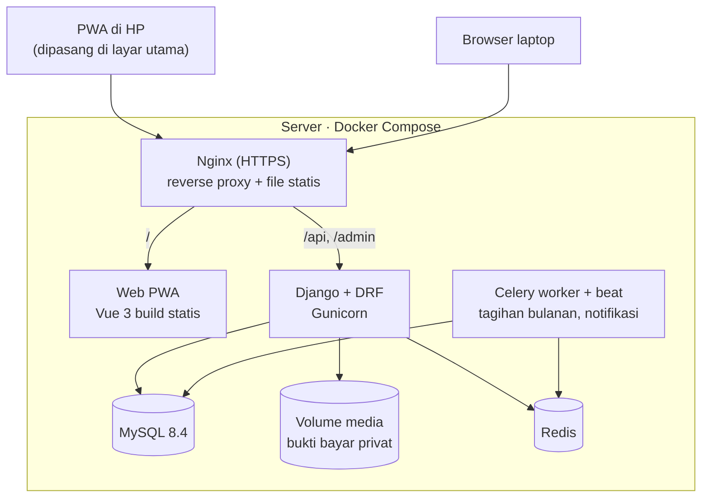

# Arsitektur Teknologi

**Keputusan:** API dengan **Django**, database **MySQL**, aplikasi HP berupa **PWA**.

Web dan "aplikasi HP" adalah **satu aplikasi frontend yang sama** (PWA). Di laptop tampil dengan sidebar. Di HP, setelah dipasang ke layar utama, tampil layar penuh dengan navigasi bawah seperti aplikasi native. Keduanya memakai satu Django API dan satu database, sehingga data selalu sinkron.



## Komponen

| Lapisan | Teknologi | Peran |
|---|---|---|
| Frontend (web + HP) | **Vue 3 + Vite + TypeScript + Tailwind CSS + Pinia + Vue Router**, `vite-plugin-pwa` | Satu kode untuk laptop & HP. Manifest + service worker agar bisa dipasang dan tetap terbuka saat sinyal lemah. |
| API | **Django 5.2 LTS + Django REST Framework** | Semua aturan bisnis & hak akses |
| Admin panel | **Django Admin** bawaan | Dipakai peran *admin*: kelola pengguna, jenis iuran, pengaturan RT. Tidak perlu dibuat UI-nya. |
| Database | **MySQL 8.4 LTS** (`utf8mb4`) via driver `mysqlclient` | Data utama |
| Tugas latar | **Celery + Redis** (`celery beat` untuk jadwal) | Buat tagihan tiap tanggal 1, kirim notifikasi, kompres foto bukti |
| File | Volume lokal `media/` (privat) | Bukti bayar, foto warga, sampul berita |
| Web server | **Nginx** + **Gunicorn** | HTTPS, sajikan PWA & file statis, teruskan `/api` ke Django |
| Dokumentasi API | `drf-spectacular` (OpenAPI/Swagger di `/api/docs/`) | Kontrak API antara frontend & backend |

> Alternatif frontend: **Django template + HTMX** (tanpa Node.js) juga bisa dijadikan PWA. Pilihan Vue dipertahankan karena tampilan "seperti aplikasi" (transisi halaman, navigasi bawah, cache offline) jauh lebih mudah dibuat sebagai SPA.

## Struktur repositori

```
aplikasi_rt/
├── backend/                  # Django
│   ├── config/               # settings.py, urls.py, celery.py, wsgi.py
│   ├── apps/
│   │   ├── accounts/         # User kustom (role: admin/pengurus/warga), login/logout
│   │   ├── residents/        # Household, Resident, ChangeRequest
│   │   ├── dues/             # FeeType, Bill, Payment, PaymentProof, tugas Celery tagihan
│   │   ├── posts/            # Post (berita/kegiatan)
│   │   └── core/             # permission bersama, AuditLog, utilitas
│   ├── requirements.txt
│   ├── Dockerfile
│   └── manage.py
├── web/                      # Vue 3 PWA
│   ├── src/{api,stores,views,components,layouts}
│   └── vite.config.ts
├── docker/nginx/             # konfigurasi nginx produksi
├── compose.yaml              # pengembangan
├── compose.prod.yaml         # produksi
└── docs/
```

## Keputusan teknis penting

### Autentikasi
- PWA dan API **berada di domain yang sama** (Nginx: `/` → PWA, `/api` → Django). Karena itu dipakai **session cookie Django + CSRF** (DRF `SessionAuthentication`): cookie `HttpOnly`, tanpa token di `localStorage`, dan sederhana.
- Frontend mengirim header `X-CSRFToken` dari cookie `csrftoken` (axios: `xsrfCookieName='csrftoken'`, `xsrfHeaderName='X-CSRFToken'`).
- Jika kelak ada aplikasi native atau klien di domain lain, tambahkan `djangorestframework-simplejwt` tanpa mengubah endpoint.

### Hak akses
- `User.role` ∈ `admin | pengurus | warga`, dan `User.resident` menautkan akun ke data warganya.
- Setiap ViewSet membatasi **queryset** di `get_queryset()`. Warga hanya mendapat baris milik `request.user.resident.household`. Permission class (`IsPengurus`, `IsOwnerHousehold`) menjadi lapis kedua.
- Rekap iuran keseluruhan untuk warga memakai **serializer terpisah** (`BillSummaryPublicSerializer`) yang memang tidak memuat field sensitif.

### Database (MySQL)
- `OPTIONS = {"charset": "utf8mb4", "init_command": "SET sql_mode='STRICT_TRANS_TABLES'"}`.
- `TIME_ZONE = "Asia/Jakarta"`, `USE_TZ = True`. Django menyimpan waktu dalam UTC. Muat tabel zona waktu MySQL (`mysql_tzinfo_to_sql`) jika memakai lookup `__date`/`__month` pada `DateTimeField`.
- Uang: `PositiveIntegerField` (rupiah), bukan `DecimalField`/float.
- NIK/No. KK: enkripsi field (misalnya `django-fernet-encrypted-fields`) dan simpan juga *hash* untuk pencarian/unik.
- **Model `User` kustom dibuat sebelum migrasi pertama** (`AUTH_USER_MODEL = "accounts.User"`). Menggantinya setelah ada migrasi sangat merepotkan.

### File bukti bayar (privat)
Bukti bayar **tidak** disajikan dari folder publik. Django memeriksa hak akses, lalu membalas dengan header `X-Accel-Redirect: /protected-media/<path>`. Nginx melayani file dari lokasi `internal`, sehingga URL tidak bisa ditebak dan dibuka orang lain.

### Tugas terjadwal
`celery beat` menjalankan `dues.tasks.generate_monthly_bills` setiap tanggal 1 pukul 00.05 WIB. Tugas ini idempoten berkat indeks unik `(household, fee_type, period)`, jadi aman dijalankan ulang. Untuk awal yang lebih sederhana, perintah `manage.py generate_bills` + cron juga cukup.

### PWA
- `display: "standalone"`, ikon 192/512 px, `theme_color`.
- Service worker meng-cache *app shell* dan respons GET terakhir (berita, rekap), sehingga aplikasi tetap terbuka saat offline. Aksi tulis (unggah bukti, simpan data) membutuhkan koneksi.
- Wajib **HTTPS** di produksi (syarat service worker dan akses kamera untuk foto bukti).
- Notifikasi push via Web Push (`pywebpush`) bisa ditambahkan di tahap 2. Di iPhone, push hanya berfungsi jika PWA sudah dipasang ke layar utama (iOS 16.4+).

## Kapan mulai memakai Docker?

**Mulai sekarang, sejak hari pertama.** Jangan menunggu aplikasi jadi.

| | Docker sejak awal | Docker belakangan |
|---|---|---|
| Versi MySQL, Python, Redis | sama persis dengan produksi | bisa berbeda dengan di laptop, dan bug baru muncul saat deploy |
| Pemasangan `mysqlclient` | sudah beres di image | sering gagal di host (butuh `libmysqlclient-dev`, compiler) |
| Konfigurasi (env, host DB, path media/static) | sudah dirancang untuk container | harus dibongkar ulang: `localhost` → `db`, path hard-coded, dll. |
| Celery, Redis, Nginx | jalan bersama dengan `docker compose up` | harus dipasang dan dijalankan satu per satu di host |
| Pindah laptop / tambah developer | `git clone` + `docker compose up` | setup manual berjam-jam |

Docker sejak awal **bukan berarti** sudah membuat image produksi. Ada dua tahap:
1. **Pengembangan (sekarang):** `compose.yaml` dengan *bind mount* kode, `runserver` dan Vite dev server yang auto-reload. Edit file di editor seperti biasa, dan perubahan langsung terlihat.
2. **Produksi (menjelang rilis):** `compose.prod.yaml` dengan image *multi-stage* (kode disalin ke image, Gunicorn, PWA hasil build disajikan Nginx). Karena dev sudah memakai container, langkah ini tinggal menambah stage, bukan memindahkan aplikasi.

Kompromi jika laptop berat: jalankan **hanya MySQL & Redis** di Docker dan Django/Vite di host (venv). Ini tetap jauh lebih baik daripada tanpa Docker sama sekali.

Langkah lengkapnya ada di [`03-pengembangan-docker.md`](03-pengembangan-docker.md).
