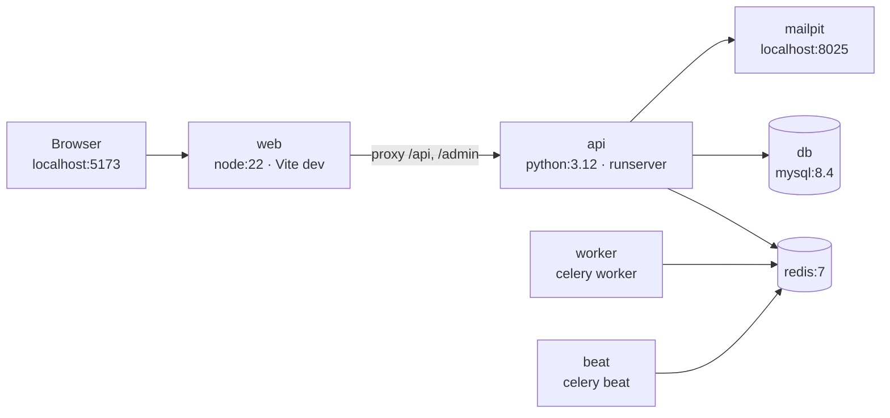
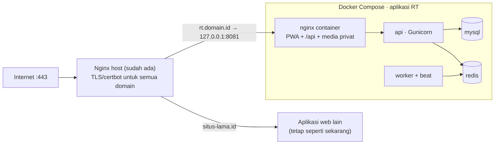

# Langkah Pengembangan dengan Docker (Django + MySQL + Vue PWA)

> **Semua file di panduan ini sudah ada di repo** (`compose.yaml`, `backend/Dockerfile`, `compose.prod.yaml`, `docker/nginx/`, dll.). Untuk mulai bekerja cukup ikuti bagian "Menjalankan" di [README](../README.md). Panduan ini menjelaskan isi dan alasan setiap file. Langkah 4–5 (membuat proyek dari nol) tidak perlu diulang.

## Gambaran container (pengembangan)



| Service | Fungsi | Port di host |
|---|---|---|
| `api` | Django `runserver` (auto-reload) | `8000` |
| `worker` | Celery worker: notifikasi, kompres foto | — |
| `beat` | Celery beat: jadwal tagihan bulanan | — |
| `db` | MySQL 8.4 | `3306` |
| `redis` | Broker Celery & cache | — |
| `web` | Vite dev server (Vue PWA) | `5173` |
| `mailpit` | Penangkap email untuk dev | `8025` |

Di pengembangan tidak ada Nginx. Vite mem-*proxy* `/api` dan `/admin` ke Django, sehingga browser melihat satu origin (`localhost:5173`) dan session cookie + CSRF bekerja sama seperti di produksi.

---

## Langkah 0 — Persiapan

1. Pasang Docker Engine di WSL2 (atau Docker Desktop dengan integrasi WSL). Cek dengan `docker compose version`.
2. Simpan proyek di filesystem Linux (`~/aplikasi_rt`), bukan `/mnt/c/...`.
3. Ekspor UID/GID agar file yang dibuat container dimiliki user Anda, bukan root (cukup sekali):
   ```bash
   echo 'export UID GID=$(id -g)' >> ~/.bashrc && source ~/.bashrc
   ```

## Langkah 1 — Struktur folder & dependensi Python

```bash
cd ~/aplikasi_rt
mkdir -p backend web docker/nginx
```

`backend/requirements.txt`:
```text
Django>=5.2,<5.3
djangorestframework>=3.15
django-filter>=24.0
drf-spectacular>=0.27
django-environ>=0.11
mysqlclient>=2.2
celery[redis]>=5.4
Pillow>=10.4
gunicorn>=23.0
# tes
pytest>=8.0
pytest-django>=4.9
factory-boy>=3.3
```

## Langkah 2 — `backend/Dockerfile` (multi-stage: dev & prod)

```dockerfile
FROM python:3.12-slim AS base
ENV PYTHONDONTWRITEBYTECODE=1 PYTHONUNBUFFERED=1
# Library yang dibutuhkan untuk meng-compile mysqlclient
RUN apt-get update \
 && apt-get install -y --no-install-recommends build-essential pkg-config default-libmysqlclient-dev \
 && rm -rf /var/lib/apt/lists/*
WORKDIR /app
COPY requirements.txt .
RUN pip install --no-cache-dir -r requirements.txt
ARG UID=1000
ARG GID=1000
RUN groupadd -g ${GID} app && useradd -m -u ${UID} -g app app

# --- Pengembangan: kode di-mount dari host ---
FROM base AS dev
USER app
CMD ["python", "manage.py", "runserver", "0.0.0.0:8000"]

# --- Produksi: kode disalin ke image ---
FROM base AS prod
COPY --chown=app:app . .
USER app
CMD ["gunicorn", "config.wsgi:application", "--bind", "0.0.0.0:8000", "--workers", "3"]
```

## Langkah 3 — `compose.yaml` (root proyek)

```yaml
x-django: &django
  build:
    context: ./backend
    target: dev
    args:
      UID: ${UID:-1000}
      GID: ${GID:-1000}
  image: aplikasi-rt-api:dev
  env_file: ./backend/.env
  volumes:
    - ./backend:/app
  depends_on:
    db:
      condition: service_healthy
    redis:
      condition: service_started

services:
  api:
    <<: *django
    ports:
      - "8000:8000"

  worker:
    <<: *django
    command: celery -A config worker -l info

  beat:
    <<: *django
    command: celery -A config beat -l info -s /tmp/celerybeat-schedule

  db:
    image: mysql:8.4
    command: --character-set-server=utf8mb4 --collation-server=utf8mb4_unicode_ci
    environment:
      MYSQL_DATABASE: aplikasi_rt
      MYSQL_USER: rt
      MYSQL_PASSWORD: rahasia
      MYSQL_ROOT_PASSWORD: rahasia-root
      TZ: Asia/Jakarta
    ports:
      - "3306:3306"
    volumes:
      - dbdata:/var/lib/mysql
    healthcheck:
      test: ["CMD", "mysqladmin", "ping", "-h", "127.0.0.1", "-prahasia-root"]
      interval: 5s
      retries: 20

  redis:
    image: redis:7-alpine

  web:
    image: node:22-alpine
    user: "${UID:-1000}:${GID:-1000}"
    working_dir: /app
    volumes:
      - ./web:/app
    command: sh -c "npm install && npm run dev -- --host 0.0.0.0"
    ports:
      - "5173:5173"
    depends_on:
      - api

  mailpit:
    image: axllent/mailpit
    ports:
      - "8025:8025"

volumes:
  dbdata:
```

> Pada Langkah 4–5, `worker` dan `beat` belum bisa jalan karena proyek Django belum ada. Itu normal.

## Langkah 4 — Buat proyek Django

`backend/.env` (jangan di-commit; buat juga `backend/.env.example` tanpa rahasia):
```dotenv
DEBUG=True
SECRET_KEY=ganti-dengan-string-acak-panjang
ALLOWED_HOSTS=localhost,127.0.0.1,api
CSRF_TRUSTED_ORIGINS=http://localhost:5173
DATABASE_URL=mysql://rt:rahasia@db:3306/aplikasi_rt
CELERY_BROKER_URL=redis://redis:6379/0
EMAIL_URL=smtp://mailpit:1025
```

```bash
docker compose build api
docker compose run --rm --no-deps api django-admin startproject config .
docker compose run --rm --no-deps api sh -c "mkdir -p apps/accounts apps/residents apps/dues apps/posts apps/core && for a in accounts residents dues posts core; do python manage.py startapp \$a apps/\$a; done"
```

Untuk setiap app, ubah `name` di `apps/<nama>/apps.py` menjadi `"apps.<nama>"` agar sesuai dengan lokasi foldernya.

Bagian penting `backend/config/settings.py`:
```python
import environ
from pathlib import Path

BASE_DIR = Path(__file__).resolve().parent.parent
env = environ.Env()
environ.Env.read_env(BASE_DIR / ".env")

DEBUG = env.bool("DEBUG", False)
SECRET_KEY = env("SECRET_KEY")
ALLOWED_HOSTS = env.list("ALLOWED_HOSTS")
CSRF_TRUSTED_ORIGINS = env.list("CSRF_TRUSTED_ORIGINS", default=[])

INSTALLED_APPS = [
    "django.contrib.admin", "django.contrib.auth", "django.contrib.contenttypes",
    "django.contrib.sessions", "django.contrib.messages", "django.contrib.staticfiles",
    "rest_framework", "django_filters", "drf_spectacular",
    "apps.accounts", "apps.residents", "apps.dues", "apps.posts", "apps.core",
]

AUTH_USER_MODEL = "accounts.User"   # WAJIB sebelum migrasi pertama

DATABASES = {"default": env.db("DATABASE_URL")}
DATABASES["default"]["OPTIONS"] = {
    "charset": "utf8mb4",
    "init_command": "SET sql_mode='STRICT_TRANS_TABLES'",
}

LANGUAGE_CODE = "id"
TIME_ZONE = "Asia/Jakarta"
USE_TZ = True

STATIC_URL = "/static/"
STATIC_ROOT = BASE_DIR / "staticfiles"
MEDIA_ROOT = BASE_DIR / "media"          # privat, disajikan lewat X-Accel-Redirect

REST_FRAMEWORK = {
    "DEFAULT_AUTHENTICATION_CLASSES": ["rest_framework.authentication.SessionAuthentication"],
    "DEFAULT_PERMISSION_CLASSES": ["rest_framework.permissions.IsAuthenticated"],
    "DEFAULT_FILTER_BACKENDS": ["django_filters.rest_framework.DjangoFilterBackend"],
    "DEFAULT_PAGINATION_CLASS": "rest_framework.pagination.PageNumberPagination",
    "PAGE_SIZE": 25,
    "DEFAULT_SCHEMA_CLASS": "drf_spectacular.openapi.AutoSchema",
}

CELERY_BROKER_URL = env("CELERY_BROKER_URL")
CELERY_TIMEZONE = TIME_ZONE
EMAIL_CONFIG = env.email_url("EMAIL_URL", default="consolemail://")
vars().update(EMAIL_CONFIG)
```

`backend/config/celery.py`:
```python
import os
from celery import Celery
from celery.schedules import crontab

os.environ.setdefault("DJANGO_SETTINGS_MODULE", "config.settings")
app = Celery("config")
app.config_from_object("django.conf:settings", namespace="CELERY")
app.autodiscover_tasks()
app.conf.beat_schedule = {
    "tagihan-bulanan": {
        "task": "apps.dues.tasks.generate_monthly_bills",
        "schedule": crontab(day_of_month=1, hour=0, minute=5),
    },
}
```
Lalu di `backend/config/__init__.py` tambahkan: `from .celery import app as celery_app`.

`backend/pytest.ini`:
```ini
[pytest]
DJANGO_SETTINGS_MODULE = config.settings
python_files = tests.py test_*.py
```

Buat model `User` kustom di `apps/accounts/models.py` (turunan `AbstractUser` + field `role` dan relasi ke `Resident`), **lalu** jalankan migrasi pertama:
```bash
docker compose up -d
docker compose exec api python manage.py makemigrations
docker compose exec api python manage.py migrate
docker compose exec api python manage.py createsuperuser
```

## Langkah 5 — Buat proyek Vue PWA

```bash
docker compose run --rm --no-deps web npm create vite@latest . -- --template vue-ts
docker compose run --rm --no-deps web npm install
docker compose run --rm --no-deps web npm install vue-router pinia axios
docker compose run --rm --no-deps web npm install -D tailwindcss @tailwindcss/vite vite-plugin-pwa
```

`web/vite.config.ts`:
```ts
import { defineConfig } from 'vite'
import vue from '@vitejs/plugin-vue'
import tailwindcss from '@tailwindcss/vite'
import { VitePWA } from 'vite-plugin-pwa'

export default defineConfig({
  plugins: [
    vue(),
    tailwindcss(),
    VitePWA({
      registerType: 'autoUpdate',
      manifest: {
        name: 'Aplikasi RT',
        short_name: 'RT Kita',
        theme_color: '#0f766e',
        background_color: '#ffffff',
        display: 'standalone',
        start_url: '/',
        icons: [
          { src: '/icon-192.png', sizes: '192x192', type: 'image/png' },
          { src: '/icon-512.png', sizes: '512x512', type: 'image/png' },
        ],
      },
    }),
  ],
  server: {
    proxy: {
      '/api': 'http://api:8000',
      '/admin': 'http://api:8000',
      '/static': 'http://api:8000',
    },
  },
})
```

`web/src/api/http.ts`:
```ts
import axios from 'axios'
export const http = axios.create({
  baseURL: '/api/v1',
  withCredentials: true,
  xsrfCookieName: 'csrftoken',
  xsrfHeaderName: 'X-CSRFToken',
})
```

Tambahkan `@import "tailwindcss";` di baris pertama `web/src/style.css`, lalu jalankan `docker compose up -d`.

Buka:
- Aplikasi (PWA): http://localhost:5173
- Django Admin: http://localhost:5173/admin/
- Dokumentasi API: http://localhost:8000/api/docs/ (setelah URL drf-spectacular didaftarkan)
- Mailpit: http://localhost:8025

**Mencoba di HP saat pengembangan:** buka `http://<IP-laptop>:5173` dari HP di Wi-Fi yang sama. Di WSL2, aktifkan `networkingMode=mirrored` di `%UserProfile%\.wslconfig`. Fitur "pasang ke layar utama" dan kamera hanya aktif di HTTPS atau `localhost`. Untuk mengujinya dari HP, gunakan tunnel HTTPS (misalnya `cloudflared tunnel --url http://localhost:5173`).

## Perintah sehari-hari

| Keperluan | Perintah |
|---|---|
| Nyalakan / matikan | `docker compose up -d` / `docker compose down` |
| Lihat log | `docker compose logs -f api worker web` |
| Perintah Django | `docker compose exec api python manage.py <perintah>` |
| Buat & jalankan migrasi | `docker compose exec api python manage.py makemigrations && docker compose exec api python manage.py migrate` |
| Shell Django | `docker compose exec api python manage.py shell` |
| Semua tes | `docker compose exec api pytest` |
| Tes satu file / satu fungsi | `docker compose exec api pytest apps/dues/tests/test_bills.py::test_warga_hanya_melihat_tagihan_sendiri` |
| Tes berdasarkan nama | `docker compose exec api pytest -k payment_proof` |
| Tambah paket Python | tambahkan ke `requirements.txt`, lalu `docker compose build api && docker compose up -d` |
| Tambah paket npm | `docker compose exec web npm install <paket>` |
| Konsol MySQL | `docker compose exec db mysql -urt -prahasia aplikasi_rt` |
| Jalankan tugas tagihan manual | `docker compose exec api python manage.py shell -c "from apps.dues.tasks import generate_monthly_bills as t; t()"` |
| Hapus database (⚠️ data hilang) | `docker compose down -v` |

> Tes membutuhkan izin membuat database `test_aplikasi_rt`. Berikan sekali:
> `docker compose exec db mysql -uroot -prahasia-root -e "GRANT ALL ON test_aplikasi_rt.* TO 'rt'@'%';"`

## Menuju produksi

1. **Image backend:** `docker build --target prod ./backend`. Jalankan `python manage.py collectstatic --noinput` dan `migrate` sebagai langkah deploy (atau di entrypoint).
2. **Image Nginx** berisi PWA hasil build (`docker/nginx/Dockerfile`):
   ```dockerfile
   FROM node:22-alpine AS build
   WORKDIR /web
   COPY web/package*.json ./
   RUN npm ci
   COPY web/ .
   RUN npm run build

   FROM nginx:1.27-alpine
   COPY --from=build /web/dist /usr/share/nginx/html
   COPY docker/nginx/default.conf /etc/nginx/conf.d/default.conf
   ```
3. `docker/nginx/default.conf` (inti):
   ```nginx
   # Jika ada Nginx host di depan (lihat bagian "Deploy ke VPS"), teruskan protokol aslinya (https)
   map $http_x_forwarded_proto $fwd_proto {
       default $http_x_forwarded_proto;
       ''      $scheme;
   }

   server {
       listen 80;
       client_max_body_size 10M;
       root /usr/share/nginx/html;

       proxy_set_header Host $host;
       proxy_set_header X-Forwarded-For $proxy_add_x_forwarded_for;
       proxy_set_header X-Forwarded-Proto $fwd_proto;

       location /api/   { proxy_pass http://api:8000; }
       location /admin/ { proxy_pass http://api:8000; }
       location /static/ { alias /app/staticfiles/; }

       # Hanya bisa diakses lewat X-Accel-Redirect dari Django (setelah cek hak akses)
       location /protected-media/ { internal; alias /app/media/; }

       # SPA/PWA: semua route lain ke index.html
       location / { try_files $uri $uri/ /index.html; }
   }
   ```
   Di Django set `SECURE_PROXY_SSL_HEADER = ("HTTP_X_FORWARDED_PROTO", "https")` agar Django tahu request aslinya HTTPS.
4. `compose.prod.yaml`: service `nginx`, `api` (target `prod`, tanpa bind mount kode), `worker`, `beat`, `db`, `redis`. Volume `media` dan `staticfiles` dipakai bersama oleh `api` dan `nginx`. Tidak ada `web`/`mailpit`.
5. **HTTPS:** taruh Caddy/Traefik di depan, atau gunakan certbot di nginx. PWA wajib HTTPS.
6. **Keamanan produksi:** `DEBUG=False`, `SECRET_KEY` & password DB dari env server, `SESSION_COOKIE_SECURE=True`, `CSRF_COOKIE_SECURE=True`, port 3306 tidak dibuka ke publik.
7. **Backup harian:** `mysqldump` + arsip volume `media`.

---

## Deploy ke VPS yang sudah punya Nginx (tanpa Docker) untuk aplikasi lain

**Rekomendasi: aplikasi RT tetap di Docker. Nginx host tetap menjadi pintu depan untuk semua domain.** Aplikasi lain di VPS tidak perlu diubah.



### Kenapa tetap Docker?
- **Tidak mengganggu aplikasi lain.** Versi Python, MySQL, Redis, dan library aplikasi RT terisolasi di container. Tidak ada risiko bentrok dengan paket yang dipakai aplikasi lama (misalnya versi PHP/Python/MySQL berbeda).
- **Sama dengan pengembangan.** Yang jalan di VPS adalah image yang sama dengan yang diuji di laptop.
- **Mudah dipindah dan di-rollback:** `git pull && docker compose up -d --build`. Jika rusak, kembali ke commit sebelumnya.
- **Perubahan di host minimal:** pasang Docker + tambah **satu** file server block Nginx. Hanya itu.

### Pembagian tugas
| Tugas | Siapa |
|---|---|
| Port 80/443, sertifikat HTTPS (certbot), routing per domain | **Nginx host** (yang sudah ada) |
| Menyajikan file PWA, `/api`, `/admin`, `/static`, media privat (`X-Accel-Redirect`) | **nginx container** milik aplikasi RT |
| Django, Celery, MySQL, Redis | container |

Nginx host cukup meneruskan semua request domain RT ke satu port lokal. Semua aturan khusus aplikasi RT tetap di repo (`docker/nginx/default.conf`), tidak tersebar di konfigurasi server.

> Varian lain: Nginx host langsung menyajikan file PWA dan memproksi ke Gunicorn, tanpa nginx container. Cara ini menghemat ±10 MB RAM, tetapi file statis/media harus di-*bind mount* ke host dengan izin yang pas untuk `www-data`, dan konfigurasi aplikasi pindah ke server. Tidak disarankan kecuali RAM sangat terbatas.

### Langkah deploy

1. **Cek sumber daya VPS.** Aplikasi RT (Django + Celery + MySQL + Redis + nginx) butuh sekitar **700 MB–1 GB RAM**. Cek dengan `free -h`. Jika RAM ≤ 1 GB, tambahkan swap 1–2 GB, jalankan Celery dengan `--concurrency=1`, atau gunakan MySQL yang sudah ada di host (lihat catatan di bawah).
2. **Pasang Docker Engine** (panduan resmi docs.docker.com untuk distro VPS). Instalasi ini tidak menyentuh Nginx atau aplikasi lain.
3. **Ambil kode & isi rahasia produksi:**
   ```bash
   sudo mkdir -p /opt/aplikasi-rt && sudo chown $USER: /opt/aplikasi-rt
   git clone <repo> /opt/aplikasi-rt && cd /opt/aplikasi-rt
   cp backend/.env.example backend/.env.prod   # isi SECRET_KEY, password DB, domain
   ```
   Isi penting `backend/.env.prod`:
   ```dotenv
   DEBUG=False
   ALLOWED_HOSTS=rt.domain.id
   CSRF_TRUSTED_ORIGINS=https://rt.domain.id
   DATABASE_URL=mysql://rt:<password-kuat>@db:3306/aplikasi_rt
   CELERY_BROKER_URL=redis://redis:6379/0
   ```
4. **`compose.prod.yaml`** (inti). **Hanya nginx container yang membuka port, dan hanya ke `127.0.0.1`:**
   ```yaml
   x-django: &django
     build: { context: ./backend, target: prod }
     env_file: ./backend/.env.prod
     volumes:
       - media:/app/media
       - staticfiles:/app/staticfiles
     restart: unless-stopped
     depends_on:
       db: { condition: service_healthy }

   services:
     nginx:
       build: { context: ., dockerfile: docker/nginx/Dockerfile }
       ports:
         - "127.0.0.1:8081:80"      # JANGAN "8081:80" — lihat peringatan firewall
       volumes:
         - media:/app/media:ro
         - staticfiles:/app/staticfiles:ro
       depends_on: [api]
       restart: unless-stopped
     api:
       <<: *django
     worker:
       <<: *django
       command: celery -A config worker -l info --concurrency=2
     beat:
       <<: *django
       command: celery -A config beat -l info -s /tmp/celerybeat-schedule
     db:
       image: mysql:8.4
       command: --character-set-server=utf8mb4 --collation-server=utf8mb4_unicode_ci
       env_file: ./.env.db          # MYSQL_DATABASE, MYSQL_USER, MYSQL_PASSWORD, MYSQL_ROOT_PASSWORD
       volumes: [dbdata:/var/lib/mysql]
       healthcheck:
         test: ["CMD-SHELL", "mysqladmin ping -h 127.0.0.1 -p$$MYSQL_ROOT_PASSWORD"]
         interval: 5s
         retries: 20
       restart: unless-stopped
     redis:
       image: redis:7-alpine
       restart: unless-stopped

   volumes: { dbdata: {}, media: {}, staticfiles: {} }
   ```
5. **Jalankan:**
   ```bash
   docker compose -f compose.prod.yaml up -d --build
   docker compose -f compose.prod.yaml exec api python manage.py migrate
   docker compose -f compose.prod.yaml exec api python manage.py collectstatic --noinput
   docker compose -f compose.prod.yaml exec api python manage.py createsuperuser
   curl -I http://127.0.0.1:8081      # harus 200
   ```
6. **Tambah server block di Nginx host**, `/etc/nginx/sites-available/aplikasi-rt`:
   ```nginx
   server {
       listen 80;
       server_name rt.domain.id;
       client_max_body_size 10M;

       location / {
           proxy_pass http://127.0.0.1:8081;
           proxy_set_header Host $host;
           proxy_set_header X-Real-IP $remote_addr;
           proxy_set_header X-Forwarded-For $proxy_add_x_forwarded_for;
           proxy_set_header X-Forwarded-Proto $scheme;
       }
   }
   ```
   ```bash
   sudo ln -s /etc/nginx/sites-available/aplikasi-rt /etc/nginx/sites-enabled/
   sudo nginx -t && sudo systemctl reload nginx
   sudo certbot --nginx -d rt.domain.id     # HTTPS, sama seperti domain lain
   ```
   `nginx -t` memeriksa semua konfigurasi sebelum reload, sehingga situs lain aman. `reload` tidak memutus koneksi yang sedang berjalan.
7. **Django di belakang proxy:** di `settings.py` produksi set `SECURE_PROXY_SSL_HEADER = ("HTTP_X_FORWARDED_PROTO", "https")`, `SESSION_COOKIE_SECURE = True`, dan `CSRF_COOKIE_SECURE = True`.
8. **Update berikutnya:**
   ```bash
   cd /opt/aplikasi-rt && git pull
   docker compose -f compose.prod.yaml up -d --build
   docker compose -f compose.prod.yaml exec api python manage.py migrate
   docker compose -f compose.prod.yaml exec api python manage.py collectstatic --noinput
   ```
9. **Backup harian (cron host):**
   ```bash
   docker compose -f /opt/aplikasi-rt/compose.prod.yaml exec -T db sh -c 'mysqldump -uroot -p"$MYSQL_ROOT_PASSWORD" aplikasi_rt' | gzip > /backup/rt-$(date +%F).sql.gz
   ```
   Arsipkan juga volume `media` (bukti bayar).

### ⚠️ Peringatan firewall
Docker menulis aturan iptables sendiri. Port yang dipublikasikan sebagai `"8081:80"` **tetap terbuka ke internet walaupun UFW memblokirnya.** Karena itu selalu tulis `127.0.0.1:` di depan port, dan jangan publikasikan port MySQL/Redis sama sekali di produksi.

### Bagaimana jika VPS sudah punya MySQL?
- **Default: tetap pakai MySQL container.** Data, versi, dan backup aplikasi RT terpisah dari aplikasi lain.
- **Pakai MySQL host** hanya jika RAM terbatas (menghemat ±300–400 MB). Caranya:
  - Buat database dan user khusus.
  - Di compose, tambahkan `extra_hosts: ["host.docker.internal:host-gateway"]` dan ubah `DATABASE_URL` ke `host.docker.internal`.
  - Atur `bind-address` MySQL agar menerima koneksi dari bridge Docker (misalnya `172.17.0.1`), dan beri `GRANT` untuk user dari subnet Docker.
  - Pastikan versi MySQL host ≥ 8.0.

### Kapan tidak perlu Docker sama sekali?
Jika RAM VPS ≤ 1 GB dan tidak bisa ditambah, atau Anda sudah terbiasa mengelola server manual, aplikasi bisa dijalankan langsung di host:
- **Django/Gunicorn:** virtualenv + systemd service, di belakang Nginx host.
- **Celery worker dan beat:** dua systemd service terpisah.
- **Database & antrean:** MySQL dan Redis dari paket distro.

Kekurangannya: versi Python/MySQL bisa bentrok dengan aplikasi lain, `mysqlclient` harus di-compile di server, dan setiap update dilakukan manual. Selama pengembangan tetap memakai Docker, pindah ke cara ini tetap mudah karena konfigurasi sudah berbasis env.
